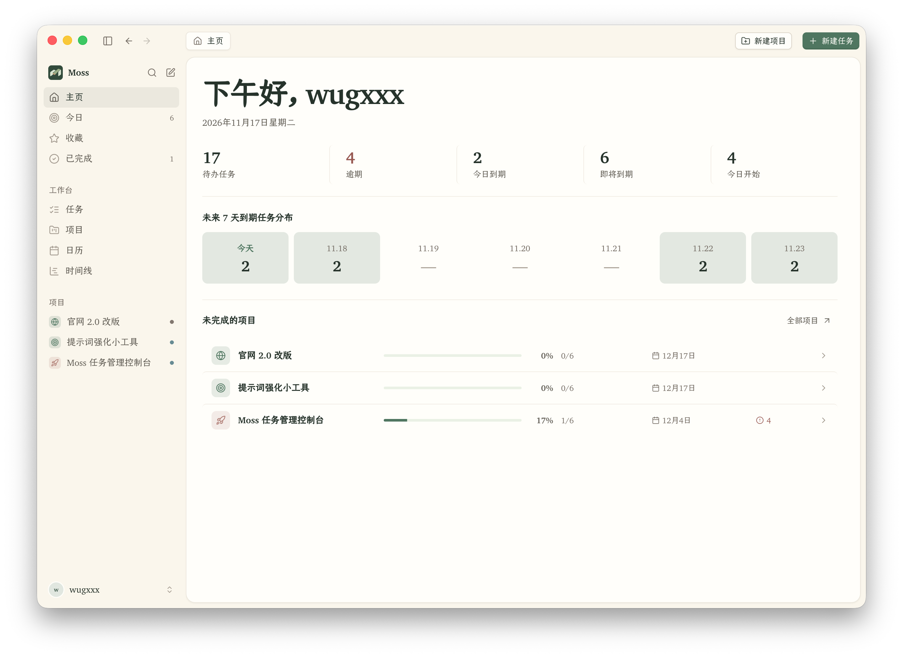
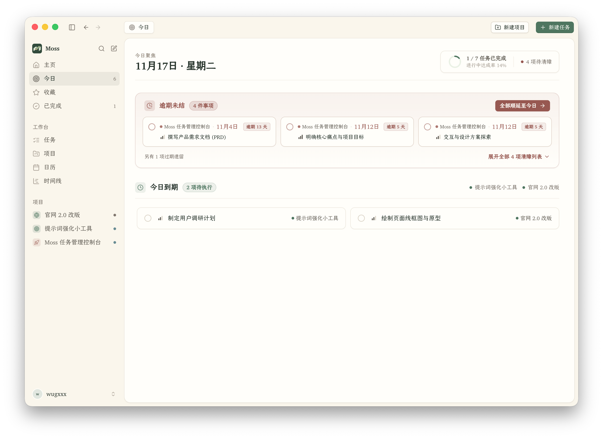

# Moss

**English** · [简体中文](README.zh-CN.md)

A calm, local-first project workspace for solo work. It keeps daily commitments, project plans,
and task detail in one place: a workload home, a focused Today view, flexible task views, editable
project schedules and milestones, a calendar, and a timeline. The interface is available in
English and Simplified Chinese (`zh-CN`), and treats task and event dates as local calendar dates
without time-zone conversion.



_Home: workload snapshot, seven-day due distribution, and unfinished project progress._



_Today: overdue triage, completion progress, and tasks due today._

## Features

- **Home overview** — greeting, open, overdue, due-today and upcoming counts, a seven-day due
  distribution, and progress for every unfinished project.
- **Today focus** — a completion ring, overdue triage with one-click reschedule to today,
  expandable overdue lists, and tasks due today in a card grid.
- **Tasks** — workspace and project tasks in list, board, and table layouts, with filtering,
  sorting, grouping, bulk actions, and search.
- **Task detail** — inline editing, rich-text descriptions, status, priority, labels, start and
  due dates, recurrence, estimates, dependencies, subtasks, attachments, and favorites.
- **Projects** — overview, board, list, table, calendar, timeline, and files, plus project status,
  editable schedules, milestones, and saved views.
- **Favorites and history** — favorite tasks and projects, review completed work, and archive or
  restore items.
- **Calendar and timeline** — month and week calendars with project events and drag-to-reschedule;
  a timeline with week or month zoom, status or project grouping, dependencies, and milestones.
- **Search and keyboard use** — global search across tasks, projects, and files (including
  archived items), a command palette, and shortcuts for navigation and quick creation.
- **Local-first data** — SQLite in the desktop app, `localStorage` in the browser, JSON backup
  and restore, archive and restore, and optional sync status controls.
- **macOS menu bar** — a popover for overdue and due-today tasks with completion, undo, and direct
  opening; its menu adds quick search, navigation, settings, and launch at login.
- **Settings** — light, dark, or system themes, accent colours, density, language, date and time
  formats, week start, workspace labels, startup view, default project view, and local profile.

Moss is built with plain JavaScript ES modules and CSS, bundled by [Vite](https://vite.dev). There
is no UI framework; the only runtime dependency is the bundled Charter webfont. The web build
stores data in browser `localStorage`; JSON export and import are available under Settings -> Data
& backup. In the desktop build, attachment bytes are stored under the app's managed user-data
directory while metadata and the sync outbox live in SQLite. Startup removes orphaned attachment
blobs. The browser build remains metadata-only for attachment contents. Closing the desktop window
keeps Moss running on macOS; right-clicking the menu bar icon opens quick actions, navigation,
settings, launch-at-login, and quit.

## Getting started

Requires Node.js 24 or newer. The desktop main process uses Node's built-in
`node:sqlite`; `.nvmrc` pins 24.

```bash
npm install
npm run brand:assets # regenerate favicon, desktop icon, and menu bar template
npm run dev       # http://localhost:8080 with hot reload
npm run build     # production build in dist/
npm run dev:desktop # Vite renderer plus the Electron desktop shell
npm run pack      # unpacked desktop app in release/
npm run dist      # platform installer artefacts in release/
npm run preview   # serve the production build locally
npm run typecheck # strict TypeScript check for shared packages
npm test          # unit, contract, sync and SQLite integration tests
npm run lint      # ESLint
npm run format    # Prettier
```

## Conventions

- **Rendering:** each page or view is a function that returns an HTML string from the store
  (`S`). `render()` rebuilds the shell and keeps focus and scroll positions.
- **Interactions:** elements declare `data-a="actionName"`. `actions/events.js` delegates the
  click to `A.actionName`. Inputs use `data-in`, blur handlers use `data-blur`. Business writes
  go through `runCommand()` and the `WorkspaceClient`.
- **Layout:** every page edge uses `var(--gutter)`, so the breadcrumb, page header, toolbar,
  list, table and board start on the same line.
- **Dropdowns:** write a normal `<select class="select">`. `ui/select.js` renders it as the
  design-system menu and keeps the native element as the source of truth.
- **Icons:** call `ic('name')` with any [Lucide](https://lucide.dev) icon name. The
  `virtual:icons` plugin bundles only the icons the source uses.
- **Localization:** user-facing strings go through `t('namespace.key')`. Keep locale catalogues
  structurally aligned, use `Intl` for dates and numbers, and keep stable stored IDs separate from
  display labels. `tests/i18n.test.ts` audits catalogue parity and statically referenced keys.

## Continuous integration

Every push and pull request runs lint, the format check and a production build
(`.github/workflows/ci.yml`).

## Deploy

`vercel.json` builds with Vite and serves `dist/`.

## Architecture

The local-first desktop and optional cloud sync design is documented in
[docs/architecture.md](docs/architecture.md). Remaining cloud, sync, and
hardening work is tracked in [docs/remaining-work.md](docs/remaining-work.md).

The shared packages establish command and client boundaries, pure task and project rules, and a
SQLite-backed local repository with migrations, legacy import, an outbox, and tombstones. The
offline sync engine provides HTTP push/pull, retry scheduling, ordered remote changes, durable pull
cursors, and sync status controls. A hosted API and PostgreSQL schema are still required for
cross-device sync. The web build uses browser `localStorage`; the Electron build connects to
SQLite through the typed preload adapter. Desktop workspace data lives in
`app.getPath("userData")/workspace.sqlite3`, while browser preferences and view state remain local
UI state.
