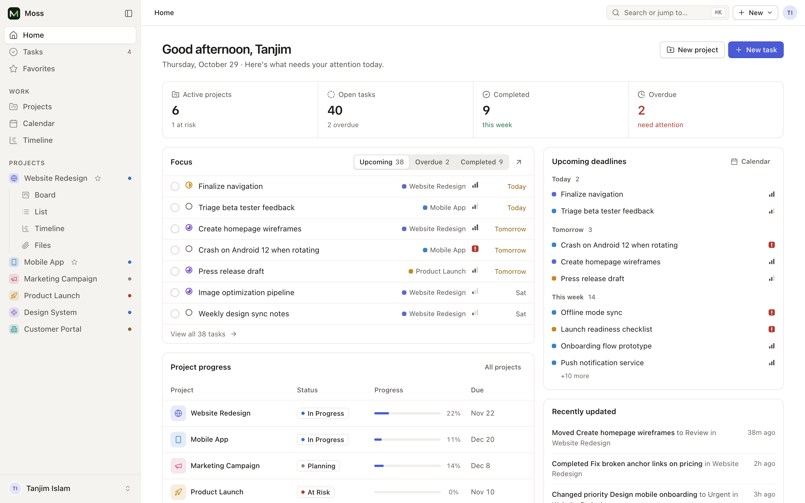

# Moss

A calm, local-first project management workspace for solo work: home dashboard, tasks, projects
with editable schedules and milestones, overview / board / list / table / calendar / timeline /
files views, calendar events, favorites, archive, global search and settings. The first release is
available in English and Simplified Chinese (`zh-CN`), and treats task and event dates as local
calendar dates without time-zone conversion.

Built with plain JavaScript ES modules and CSS, bundled by [Vite](https://vite.dev). There is no
UI framework and no runtime dependency. The web build stores data in browser `localStorage`;
JSON export and import are available under Settings -> Data & backup. In the desktop build,
attachment bytes are stored under the app's managed user-data directory while metadata and the
sync outbox live in SQLite. Startup removes orphaned attachment blobs. The browser build remains
metadata-only for attachment contents. A SQLite-backed local repository is ready for the desktop
shell.



## Getting started

Requires Node.js 24 or newer. The desktop main process uses Node's built-in
`node:sqlite`; `.nvmrc` pins 24.

```bash
npm install
npm run dev       # http://localhost:5173 with hot reload
npm run build     # production build in dist/
npm run dev:desktop # Vite renderer plus the Electron desktop shell
npm run pack      # unpacked desktop app in release/
npm run dist      # platform installer artefacts in release/
npm run preview   # serve the production build locally
npm run typecheck # strict TypeScript check for shared packages
npm test          # client/application contract and SQLite integration tests
npm run lint      # ESLint
npm run format    # Prettier
```

## Project structure

```
index.html              HTML entry; loads src/main.js
public/favicon.svg      brand mark
vite.config.js          Vite config, including the Lucide icon-subset plugin
eslint.config.js        lint rules (ESLint flat config); formatting by Prettier (.prettierrc.json)
.github/workflows/      CI: lint, format check, build
docs/preview.png        README screenshot
packages/
  contracts/            serializable entities, commands, queries, and results
  domain/                pure task and project rules
  application/           command handlers over a repository interface
  client/                WorkspaceClient interface, memory, browser, and local adapters
  local-db/               Node SQLite schema, migrations, repository, outbox, and sync runner
  sync-core/              transport-neutral sync protocol, validation, retries, and pull merging
  test-fixtures/         shared snapshots and entity builders
tests/                   package-level unit tests
src/
  main.js               entry: imports styles and modules, then boots the app
  styles/
    index.css           imports every stylesheet in cascade order
    tokens.css          colours, spacing, type, radius, the shared --gutter
    base.css  components.css  shell.css  panels.css  overlays.css  states.css  motion.css  responsive.css
    views/              list, board, table, calendar, timeline, projects & files
    pages/              settings and local data tools
  core/                 utilities, constants, icons, read store, workspace bridge, theme
  data/seed.js          initial empty workspace data
  i18n/                 locale registry, lookup/interpolation, pluralization, en and zh-CN catalogues
  ui/                   shared render helpers, toasts, the select dropdown
  shell/                render loop and router, sidebar/topbar layout, skeletons, view engine
  components/           task list renderer
  pages/                one module per route
  views/                project views: board, table, calendar, timeline, files, overview
  overlays/             task drawer, modals, popovers, context menu, command palette
  features/             subtasks and archive rendering
  actions/              user actions, event wiring, keyboard shortcuts, drag and drop
apps/desktop/           Electron main process, typed preload bridge, packaging
```

### Layers

Dependencies point inward:

1. `contracts` defines serializable entities and command/query types.
2. `domain` holds framework-free business rules.
3. `application` validates and applies commands against a repository interface.
4. `client` exposes `WorkspaceClient`; browser and memory adapters select the implementation.
5. UI actions call the shared workspace client. They do not mutate projects, tasks, files, or
   saved views directly.

`S.data` is a synchronous read cache for the renderer. It is refreshed from the client after
every command. Ephemeral UI state and device preferences stay outside the workspace command
path and may be saved directly.

## Conventions

- **Rendering:** each page or view is a function that returns an HTML string from the store
  (`S`). `render()` rebuilds the shell and keeps focus and scroll positions.
- **Interactions:** elements declare `data-a="actionName"`. `actions/events.js` delegates the
  click to `A.actionName`. Inputs use `data-in`, blur handlers use `data-blur`. Business writes
  go through `runCommand()` and the `WorkspaceClient`.
- **Layout:** every page edge uses `var(--gutter)`, so the breadcrumb, page header, toolbar,
  list, table and board start on the same line.
- **Dropdowns:** write a normal `<select class="select">`. `ui/select.js` renders it as the
  design-system menu and keeps the native element as the source of truth.
- **Icons:** call `ic('name')` with any [Lucide](https://lucide.dev) icon name. The
  `virtual:icons` plugin bundles only the icons the source uses.
- **Localization:** user-facing strings go through `t('namespace.key')`. Keep locale catalogues
  structurally aligned, use `Intl` for dates and numbers, and keep stable stored IDs separate from
  display labels. `tests/i18n.test.ts` audits catalogue parity and statically referenced keys.

## Continuous integration

Every push and pull request runs lint, the format check and a production build
(`.github/workflows/ci.yml`).

## Deploy

`vercel.json` builds with Vite and serves `dist/`.

## Architecture

The local-first desktop and optional cloud sync design is documented in
[docs/architecture.md](docs/architecture.md). Remaining cloud, sync, and
hardening work is tracked in [docs/remaining-work.md](docs/remaining-work.md).

Milestone 1 establishes the command and client boundaries. Milestone 2 adds the SQLite-backed
local repository, migrations, legacy import, outbox, and tombstones. Milestone 4 now includes
the offline sync engine: HTTP push/pull, retry scheduling, ordered remote changes, durable pull
cursors, and sync status controls. A hosted API and PostgreSQL schema are still required for
cross-device sync. The web build still uses browser `localStorage`; the Electron build connects
to SQLite through the typed preload adapter. Desktop workspace data lives in
`app.getPath("userData")/workspace.sqlite3`, while browser preferences and view state remain
local UI state.
