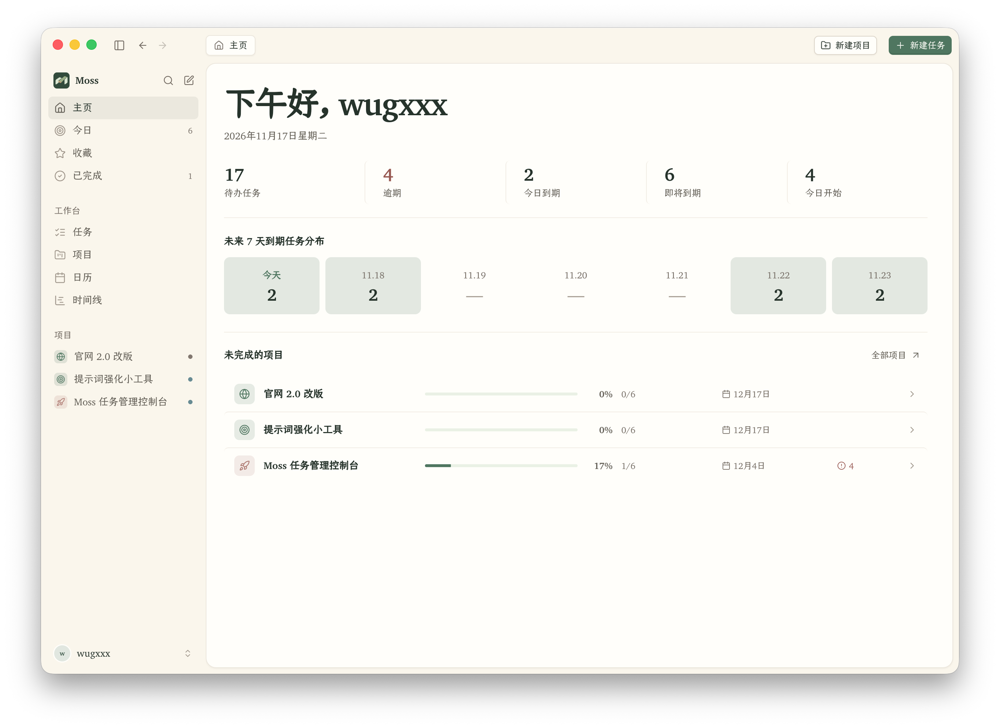
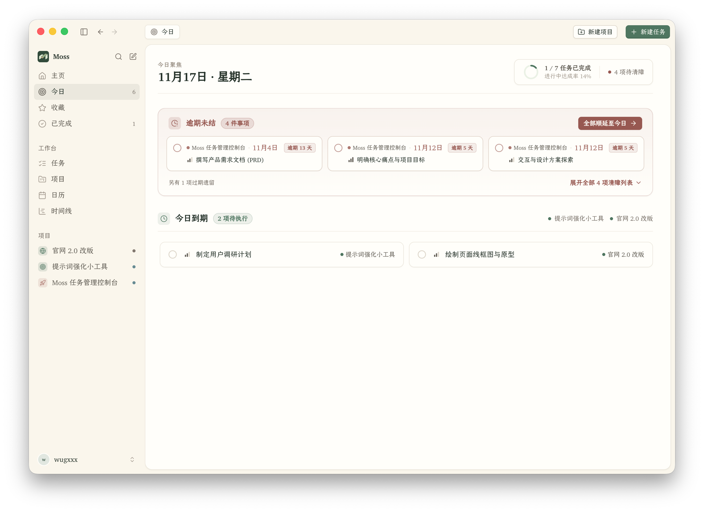

# Moss

[English](README.md) · **简体中文**

Moss 是一款安静、以本地为先的个人项目工作台，把每日承诺、项目计划和任务细节放在同一处：首页概览、今日焦点、灵活的任务视图、可编辑的项目排期与里程碑、日历和时间线。界面提供英文与简体中文（`zh-CN`），任务和事件日期按本地日历日期处理，不做时区转换。



_首页：负载概览、未来 7 天到期分布，以及未完成项目的进度。_



_今日：逾期分流、完成进度，以及今日到期的任务。_

## 功能

- **首页概览** —— 问候语、待办 / 逾期 / 今日到期 / 即将到期统计、未来 7 天到期分布，以及所有未完成项目的进度。
- **今日焦点** —— 完成进度环、逾期事项分流并可一键顺延至今日、可展开的逾期列表，以及以卡片网格呈现的今日到期任务。
- **任务** —— 工作区与项目任务支持列表、看板、表格布局，可筛选、排序、分组、批量操作和搜索。
- **任务详情** —— 行内编辑、富文本描述、状态、优先级、标签、开始与截止日期、重复规则、预估、依赖、子任务、附件和收藏。
- **项目** —— 概览、看板、列表、表格、日历、时间线和文件视图，以及项目状态、可编辑排期、里程碑和已保存视图。
- **收藏与历史** —— 收藏任务和项目、回顾已完成工作，并归档或恢复任务与项目。
- **日历与时间线** —— 月 / 周日历支持项目日程和拖放调整日期；时间线支持周 / 月缩放、按状态或项目分组、依赖关系与里程碑轨道。
- **搜索与键盘操作** —— 跨任务、项目和文件（含归档内容）的全局搜索、命令面板，以及导航和快速创建快捷键。
- **本地优先数据** —— 桌面版使用 SQLite，Web 版使用 `localStorage`，支持 JSON 备份与恢复、归档与恢复，以及可选的同步状态控制。
- **macOS 菜单栏** —— 弹出面板展示逾期和今日到期任务，可完成、撤销并直接打开；菜单中提供快速搜索、导航、设置和登录时启动。
- **设置** —— 浅色、深色或跟随系统主题，强调色、密度、语言、日期与时间格式、每周起始日、工作区标签、启动页面、默认项目视图和本地个人资料。

Moss 使用原生 JavaScript ES modules 和 CSS 构建，由 [Vite](https://vite.dev) 打包；不使用 UI 框架，唯一的运行时依赖是内置的 Charter 网络字体。Web 版本将数据存储在浏览器 `localStorage` 中，可在“设置 -> 数据与备份”中导出和导入 JSON。桌面版本将附件内容存储在应用托管的用户数据目录中，元数据和同步待发送队列（outbox）位于 SQLite；启动时会清理无归属的附件 blob。浏览器版本的附件仍仅保留元数据。macOS 桌面版关闭窗口后 Moss 继续运行；右键点击菜单栏图标可打开快速操作、导航、设置、登录时启动和退出。

## 快速开始

需要 Node.js 24 或更高版本。桌面主进程使用 Node 内置的 `node:sqlite`；`.nvmrc` 固定为 24。

```bash
npm install
npm run brand:assets # 从 src/core/brand.js 重新生成网站图标、桌面图标和菜单栏模板
npm run dev          # 启动 http://localhost:8080，支持热更新
npm run build        # 在 dist/ 中生成生产构建
npm run dev:desktop  # 同时启动 Vite 渲染进程和 Electron 桌面外壳
npm run pack         # 在 release/ 中生成未打包的桌面应用
npm run dist         # 在 release/ 中生成各平台安装包
npm run preview      # 在本地预览生产构建
npm run typecheck    # 对共享包执行严格 TypeScript 检查
npm test             # 单元、契约、同步和 SQLite 集成测试
npm run lint         # ESLint
npm run format       # Prettier
```

## 开发约定

- **渲染：**每个页面或视图都是一个函数，根据 store（`S`）返回 HTML 字符串。`render()` 会重建外壳，并保留焦点和滚动位置。
- **交互：**元素通过 `data-a="actionName"` 声明操作，`actions/events.js` 会将点击委托给 `A.actionName`。输入框使用 `data-in`，失焦事件使用 `data-blur`。业务写入通过 `runCommand()` 和 `WorkspaceClient` 完成。
- **布局：**每个页面边缘都使用 `var(--gutter)`，确保面包屑、页面标题、工具栏、列表、表格和看板从同一条基线开始。
- **下拉菜单：**编写普通的 `<select class="select">`。`ui/select.js` 会将其渲染为设计系统菜单，并保留原生元素作为真实数据源。
- **图标：**调用 `ic('name')` 使用任意 [Lucide](https://lucide.dev) 图标名。`virtual:icons` 插件只会打包源码中实际用到的图标。
- **本地化：**用户可见文案通过 `t('namespace.key')` 获取。各语言目录的结构应保持一致；日期和数字使用 `Intl`；持久化 ID 与展示文案保持分离。`tests/i18n.test.ts` 会检查语言目录的一致性和静态引用键。

## 持续集成

每次推送和拉取请求都会运行 lint、格式检查和生产构建（`.github/workflows/ci.yml`）。

## 部署

`vercel.json` 使用 Vite 构建，并托管 `dist/` 中的文件。

## 架构说明

本地优先桌面应用及可选云同步的设计记录在 [docs/architecture.md](docs/architecture.md) 中。剩余云同步和加固工作记录在 [docs/remaining-work.md](docs/remaining-work.md) 中。

共享包建立了命令和 client 的边界、纯任务与项目规则，以及基于 SQLite 的本地仓库，包括迁移、旧版数据导入、outbox 和 tombstone。离线同步引擎提供 HTTP 推送/拉取、重试调度、有序的远端变更、持久化拉取游标和同步状态控制。跨设备同步仍需要托管 API 和 PostgreSQL schema。Web 版本使用浏览器 `localStorage`；Electron 版本通过类型化 preload 适配器连接 SQLite。桌面工作区数据位于 `app.getPath("userData")/workspace.sqlite3`，浏览器偏好和视图状态仍作为本地 UI 状态保存。
